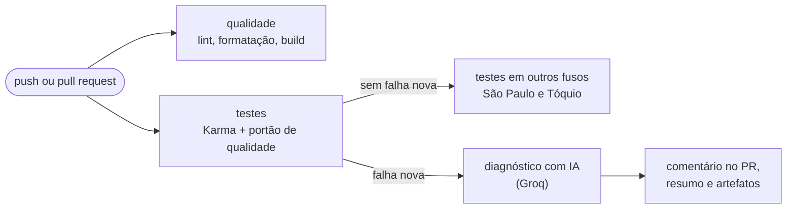

# Pipeline de CI com diagnóstico de falhas por IA generativa

Atividade da Unidade V (miniprojeto de DevOps com GenAI): um pipeline de integração contínua que
roda os testes automatizados e, quando eles falham, aciona um agente de IA generativa para
analisar a falha e sugerir a causa raiz e uma correção.

**Resumo.** O pipeline tem um job de testes com um portão de qualidade e um job de diagnóstico
que só roda quando aparece uma falha nova. O agente monta o contexto (falha, ambiente de execução,
código citado no rastro, código sob teste e diff da entrega), mascara segredos e consulta um
modelo no Groq. O resultado vira comentário no Pull Request. O agente é só leitura: não altera
código nem o resultado do pipeline.

## Sumário

1. [Pipeline](#1-pipeline)
2. [Quarentena de falhas conhecidas](#2-quarentena-de-falhas-conhecidas)
3. [Agente de diagnóstico](#3-agente-de-diagnóstico)
4. [Configuração](#4-configuração)
5. [Como reproduzir na sua máquina](#5-como-reproduzir-na-sua-máquina)
6. [Limitações](#6-limitações)
7. [Arquivos](#7-arquivos)
8. [Experimento: uma falha que só aparece no CI](#8-experimento-uma-falha-que-só-aparece-no-ci)

## 1. Pipeline

O repositório está no GitHub, então o pipeline que roda é o do GitHub Actions
([`.github/workflows/ci.yml`](../../.github/workflows/ci.yml)). O
[`.gitlab-ci.yml`](../../.gitlab-ci.yml) é o equivalente para o GitLab CI, com as mesmas etapas e
os mesmos scripts.



| Job | O que faz | Quando reprova |
| --- | --- | --- |
| `qualidade` | ESLint, Prettier, testes dos scripts de CI (`node --test`) e build de produção | Qualquer um desses passos falha |
| `testes` | Registra o ambiente, roda a suíte no Karma (ChromeHeadless) e aplica o portão de qualidade | Há falha **nova**, a execução não termina ou a cobertura fica abaixo do mínimo |
| `testes-outros-fusos` | Repete a suíte com `TZ=America/Sao_Paulo` e `TZ=Asia/Tokyo` (o runner usa UTC) | Há falha nova em algum dos fusos |
| `diagnostico-ia` | Monta o contexto, consulta o modelo e publica o diagnóstico | Nunca: é um apoio, não um portão |

Dois detalhes do job de testes:

- **Código de saída.** O log vai para a tela e para um arquivo com `npm run test:ci | tee`. Num
  pipe, o código de saída é o do `tee`, que sempre dá certo. Por isso o do Karma é lido de
  `PIPESTATUS`, e quem decide o resultado do job é o portão de qualidade.
- **Resultado por teste.** O `karma.conf.js` tem um reporter próprio, ativado pela variável
  `KARMA_RESULTADOS_JSON`, que grava o resultado de cada teste em JSON. O portão e o agente leem
  esse arquivo, e não o log, que é feito para pessoas.

## 2. Quarentena de falhas conhecidas

A suíte tem três testes que falham de propósito: eles registram defeitos reais do código, já
documentados (CI-15, CE-12 e CE-42, ver
[achados dos testes de integração](../testes-integracao/README.md#6-achados)). Com eles, o
`ng test` sempre termina com erro. Se o pipeline só repassasse esse código de saída, ficaria
vermelho para sempre e deixaria de avisar quando algo novo quebra.

O portão de qualidade ([`scripts/ci/avaliar-testes.mjs`](../../scripts/ci/avaliar-testes.mjs))
compara as falhas com a lista de [`ci/falhas-conhecidas.json`](../../ci/falhas-conhecidas.json):

| Situação | Resultado do job | Diagnóstico com IA |
| --- | --- | --- |
| Só falham testes da quarentena | Aprovado | Não roda |
| Falha um teste fora da quarentena | Reprovado | Roda |
| O Karma não chega a rodar os testes (erro de build, navegador caiu) | Reprovado | Roda, com o final do log |
| Cobertura abaixo do mínimo do `karma.conf.js` | Reprovado | Não roda |

O portão também avisa quando um teste da quarentena volta a passar ou deixa de existir, para a
lista não envelhecer. As falhas conhecidas vão para o prompt marcadas como "ignore", para a IA
não gastar a análise com elas.

## 3. Agente de diagnóstico

[`scripts/ia/diagnosticar-falha.mjs`](../../scripts/ia/diagnosticar-falha.mjs) lê os relatórios
do job de testes e chama a API do Groq (compatível com a da OpenAI). É Node puro, sem
dependências, então o job não precisa de `npm ci`.

**O que entra no prompt, em ordem de prioridade:**

1. As falhas novas: nome do teste, mensagem e rastro de pilha (sem as linhas de `node_modules`).
2. As falhas conhecidas, marcadas para ignorar.
3. O **ambiente em que os testes rodaram**: plataforma, sistema, fuso horário, localidade, Node e
   navegador. Essa informação não aparece no log do Karma.
4. O código citado no rastro de pilha. Arquivo pequeno entra inteiro, para a IA ver também os
   dados de teste definidos no topo.
5. O **código sob teste**: o módulo que o arquivo de teste importa e que dá nome a ele. A causa
   costuma estar ali, e esse arquivo quase nunca aparece no rastro.
6. O diff da entrega em relação ao commit de base, só do código de produção.
7. Os outros módulos importados.

O prompt tem um orçamento de caracteres (13.000 por padrão), porque o plano gratuito do Groq
limita os tokens por minuto. O que não cabe fica de fora, do fim da lista para o começo, e o
próprio prompt diz à IA o que ela não viu.

**Formato da resposta.** O prompt pede sete seções fixas: resumo, evidências, causa raiz com
classificação (defeito no código, defeito no teste ou problema de ambiente), correção sugerida em
diff, como validar, confiança e premissas, e prevenção. Também proíbe sugerir que o teste seja
enfraquecido ou que o pipeline seja alterado só para esconder a falha.

**Comparação com e sem ambiente.** Com `DIAG_COMPARAR_SEM_AMBIENTE=true`, o agente faz uma segunda
consulta com o mesmo prompt, sem a seção de ambiente. As duas respostas saem no mesmo comentário,
o que permite ver quanto essa informação muda o diagnóstico.

**Segurança.**

- Antes de sair do runner, o texto passa por uma máscara: valor das variáveis sensíveis do job,
  chave da OpenWeatherMap na URL (`appid=`), formatos conhecidos de credenciais e o nome de
  usuário em caminhos de pasta pessoal.
- A chave do Groq fica num segredo do CI e nunca é impressa nem gravada nos artefatos.
- Sem a chave, o agente não chama ninguém: grava o prompt como artefato e termina sem erro. É o
  que acontece em Pull Requests de forks, que não recebem segredos.
- Log, código e diff vão no prompt como dados, com a instrução de não tratar esse conteúdo como
  ordem.

**Robustez.** Erro 429 (limite por minuto) espera o tempo indicado pela API e repete. Erro 413
(requisição grande demais) reduz o contexto e repete. Qualquer outra falha vira um aviso no
comentário. O agente sempre termina com sucesso, para não mascarar nem agravar a falha original.

Os scripts têm testes próprios (`npm run test:agente`), que rodam no job `qualidade`. Eles
garantem, entre outras coisas, que os imports do arquivo de teste são resolvidos até o código sob
teste, que os segredos são mascarados e que o prompt respeita o orçamento.

## 4. Configuração

**GitHub** (Settings → Secrets and variables → Actions):

| Tipo | Nome | Valor |
| --- | --- | --- |
| Secret | `GROQ_API_KEY` | Chave criada em <https://console.groq.com/keys> |
| Variable (opcional) | `GROQ_MODEL` | Modelo a usar. Padrão: `openai/gpt-oss-120b` |

O comentário no Pull Request usa o `GITHUB_TOKEN` do próprio job, com a permissão
`pull-requests: write` declarada no workflow.

**GitLab** (Settings → CI/CD → Variables, mascaradas): `GROQ_API_KEY` e `GITLAB_API_TOKEN`, um
token de projeto com escopo `api`, usado para comentar no Merge Request.

## 5. Como reproduzir na sua máquina

Requer Node 22 e Chrome.

```bash
# os mesmos passos do job de testes (os relatórios ficam em reports/, fora do Git)
node scripts/ci/coletar-ambiente.mjs reports/ambiente.json
KARMA_RESULTADOS_JSON=reports/karma-resultados.json npm run test:ci > reports/karma.log 2>&1
node scripts/ci/avaliar-testes.mjs --codigo-karma $?

# se houver falha nova: o prompt que o agente enviaria (sem a chave, ele só grava o arquivo)
node scripts/ia/diagnosticar-falha.mjs
cat reports/diagnostico/prompt-com-ambiente.md

# testes dos scripts
npm run test:agente
```

No PowerShell, defina a variável antes do comando: `$env:KARMA_RESULTADOS_JSON = 'reports/karma-resultados.json'`.

Para rodar a suíte no fuso do runner (UTC), defina `TZ` antes: `TZ=UTC npm test` no bash, ou
`$env:TZ = 'UTC'; npm test` no PowerShell.

## 6. Limitações

- O `.gitlab-ci.yml` foi escrito como equivalente e validado só quanto à sintaxe: não foi
  executado num runner do GitLab.
- O agente enxerga o que cabe no orçamento do prompt. Uma causa que esteja a dois ou mais níveis
  de import do arquivo de teste pode ficar de fora.
- O diagnóstico é uma hipótese. Um pipeline verde depois da correção sugerida mostra que os
  testes existentes passam, e não que a correção está certa.
- O plano gratuito do Groq tem limite de requisições e de tokens por minuto. Em pipelines com
  muitas falhas simultâneas, o diagnóstico pode demorar ou não sair.

## 7. Arquivos

```text
.github/workflows/ci.yml            pipeline do GitHub Actions
.gitlab-ci.yml                      equivalente para o GitLab CI
ci/falhas-conhecidas.json           quarentena: testes que falham por defeito documentado
karma.conf.js                       reporter que grava o resultado de cada teste em JSON
scripts/ci/
├── coletar-ambiente.mjs            registra sistema, fuso, localidade, Node e navegador
├── avaliar-testes.mjs              portão de qualidade (falhas novas x quarentena)
└── avaliar-testes.test.mjs
scripts/ia/
├── contexto.mjs                    monta o prompt, mascara segredos (funções puras)
├── contexto.test.mjs
└── diagnosticar-falha.mjs          lê os relatórios, chama a API e grava o diagnóstico
src/app/shared/pipes/
├── city-time.pipe.ts               horário local da cidade (correção do experimento)
└── city-time.pipe.spec.ts
```

## 8. Experimento: uma falha que só aparece no CI

### O erro intencional

O RF04 pede o nascer e o pôr do sol no cartão do clima atual, e isso estava pendente (D02 na
[documentação de arquitetura](../arquitetura/README.md)). A funcionalidade foi implementada do
jeito mais natural, copiando o padrão do "Atualizado em" que já existia no cartão:

```html
<dd>{{ w.sunrise * 1000 | date: 'HH:mm' }}</dd>
```

O `DatePipe` sem fuso explícito formata no fuso **do navegador**, não no da cidade consultada.
O teste que acompanha a funcionalidade usa São Paulo. Numa máquina configurada para o horário de
Brasília, o fuso do navegador coincide com o da cidade, o teste passa e a tela parece certa. No
runner do CI, que usa UTC, o mesmo teste falha:

```text
WeatherCardComponent shows sunrise and sunset in the local time of the city (RF04)
  Expected '08:24' to be '05:24'.
  Expected '21:57' to be '18:57'.
```

Nada no log aponta para o fuso horário. É a lacuna L07 ("o campo `timezone` da API é lido mas não
usado") virando defeito: quem consulta Tóquio a partir do Brasil veria o sol nascer às 18:51.

### Reprodução local

Resultado da suíte completa em cada etapa, com a variável `TZ` trocada (Linux, Node 22, Chrome 153):

| Etapa | `TZ=America/Sao_Paulo` | `TZ=UTC` (como o runner) |
| --- | --- | --- |
| Antes da funcionalidade | 88 passam, 3 em quarentena | 88 passam, 3 em quarentena |
| Com a funcionalidade e o erro | 89 passam, 3 em quarentena | **1 falha nova**, 88 passam, 3 em quarentena |
| Com a correção | 95 passam, 3 em quarentena | 95 passam, 3 em quarentena |

Com a correção, o resultado em `TZ=Asia/Tokyo` é o mesmo: 95 passam, 3 em quarentena.

### O pipeline verde não prova a correção

Três implementações foram testadas nos três fusos, com os dois testes do cartão que existem depois
da correção (cidade a oeste do UTC, São Paulo, e a leste, Tóquio):

| Implementação | `America/Sao_Paulo` | `UTC` | `Asia/Tokyo` |
| --- | --- | --- | --- |
| Erro intencional: `sunrise * 1000 \| date: 'HH:mm'` | 1 falha | 2 falhas | 1 falha |
| Atalho: `(sunrise + timezone) * 1000 \| date: 'HH:mm'` | 2 falhas | **passa** | 2 falhas |
| Adotada: pipe `cityTime`, que lê o instante deslocado em UTC | passa | passa | passa |

O atalho da segunda linha soma o deslocamento da cidade, mas continua formatando no fuso do
navegador. Ele só acerta quando o navegador está em UTC, que é justamente o caso do runner. Quem
aplicasse essa correção e olhasse só para o pipeline veria tudo verde, com o defeito intacto para
qualquer usuário fora do UTC.

O outro atalho possível é fixar `TZ=America/Sao_Paulo` no pipeline. O teste de São Paulo volta a
passar e o código continua errado para qualquer cidade de outro fuso.

### Correção e prevenção

- [`city-time.pipe.ts`](../../src/app/shared/pipes/city-time.pipe.ts) formata o horário a partir
  do instante e do deslocamento da cidade, sem passar pelo fuso do navegador. Tem testes para
  deslocamento negativo, positivo com virada de dia, deslocamento que não é hora cheia e dado
  ausente.
- O cartão ganhou um segundo teste, com uma cidade a leste do UTC.
- O pipeline ganhou o job `testes-outros-fusos`. Uma dependência do fuso de quem executa agora
  falha com o fuso no nome do job, sem depender de alguém desconfiar disso ao ler o log.

O "Atualizado em" do cartão ainda usa o fuso do navegador. Essa parte da L07 continua em aberto,
porque ali a regra não está decidida.

### Execuções no GitHub Actions

<!-- PREENCHER depois de rodar o pipeline: link de cada execução e o resultado observado. -->

| Execução | Esperado | Observado | Link |
| --- | --- | --- | --- |
| 1. `master`, só com o pipeline | Aprovado: 88 passam, 3 em quarentena | _preencher_ | _preencher_ |
| 2. Pull Request com a funcionalidade | Reprovado: 1 falha nova; diagnóstico comentado no PR | _preencher_ | _preencher_ |
| 3. Pull Request com a correção | Aprovado nos três fusos: 95 passam, 3 em quarentena | _preencher_ | _preencher_ |

### O que a IA respondeu

<!-- PREENCHER com o diagnóstico real publicado no Pull Request: causa apontada, classificação,
     correção sugerida, diferença entre as variantes com e sem ambiente, e o resultado de aplicar a
     sugestão nos três fusos. -->

_A preencher com o diagnóstico publicado na execução 2._
